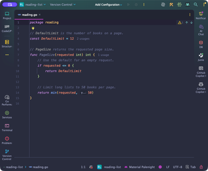
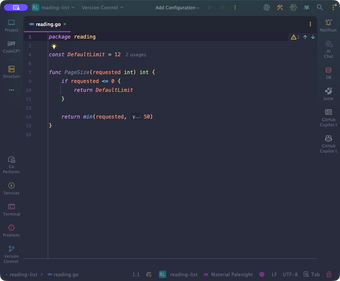

# Hide Comment Lines

Hide lines that contain only comments in JetBrains editors. The comments stay in the source file, and the surrounding code moves together on screen.

| Before · Comments visible | After · Comments hidden |
| --- | --- |
| [](docs/images/comments-visible.png) | [](docs/images/comments-hidden.png) |

## Using the plugin

Hiding is on by default. Toggle **View → Hide Comment Lines** to show the comments again. You can also find the command through **Find Action**. Each project remembers its own setting.

A comment at the end of a code line stays visible. If you copy a selection that spans a hidden comment, the copy includes it. Deleting or replacing that selection also removes the comment.

## Compatibility

Tested with Go, Java, Python, and XML. Support for other languages depends on how their JetBrains language plugins identify comments.

## Installation

[](https://plugins.jetbrains.com/plugin/36470-hide-comment-lines)

Open **Settings → Plugins → Marketplace**, search for **Hide Comment Lines**, and click **Install**.

To install a local ZIP, open **Settings → Plugins**, then open the gear menu, choose **Install Plugin from Disk…**, and select the plugin ZIP.

To build the ZIP from source, use Python 3.9 or later and a JDK compatible with your IDE’s SDK. Pass the path to your local IDE installation:

```sh
python3 build.py --ide /Applications/GoLand.app
```

The ZIP is written to `build/`.

## License

[MIT](LICENSE)
